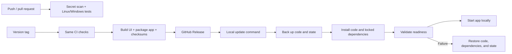

# CI/CD for the local MVP

GitHub Actions verifies changes and builds downloadable releases. Updates are
applied on the local machine with an explicit update command. No runner needs
access to the user's computer, credentials, patient state, or model artifacts.



## Continuous integration

`.github/workflows/ci.yml` runs on pushes to `main`, pull requests, manual runs,
and calls from the release workflow. It performs:

1. Gitleaks scanning of committed history.
2. Tests on both `ubuntu-latest` and `windows-latest`.
3. Python 3.12.10 (available on both GitHub runner platforms), Node 24.19.0,
   and uv 0.11.3 setup. Local deployments may use other Python 3.12 patch releases.
4. An isolated Python environment synced from `requirements.lock`.
5. Python tests, including package validation and rollback scenarios.
6. `npm ci`, `npm run build:local`, and Chromium browser workflow tests.
7. Test-result artifacts retained for seven days, including failure traces.

Browser tests generate their own small synthetic CSV, fitted Cox model, and Chroma
collection in a temporary directory. Hosted AI responses and embedding vectors are
deterministic fixtures. API routes, patient scoping, model scoring, state persistence,
approval, reports, follow-ups, reminders, chat errors, and precomputation still run
through the application. Tests disable `.env` loading and need no provider secrets.
These fixtures verify workflow behavior; they do not measure model or semantic quality.

The existing provisioned-runtime restart test skips in an unprovisioned checkout.
It remains available locally for the deployed model/store. CI's browser tests cover
disk-backed assessment/decision/report reads after volatile cache is cleared.

Workflows have read-only repository permissions by default. Actions are pinned to
commit SHAs. Only the tagged release-publishing job receives `contents: write`.

## Preview the package

In GitHub, open **Actions → Release → Run workflow**, select `main`, and use a
preview version such as `v0.0.0-preview`. After CI and packaging succeed, download
the **local-deployment** artifact. Extract its outer Actions archive to obtain:

- `care-transition-copilot-v0.0.0-preview.zip`
- `SHA256SUMS`

Manual workflow runs do not publish a GitHub Release. Source commits must belong
to `main` history before packaging. This allows the packaging path to be verified
without creating a version tag.

## Publish a version

After changes are merged into `main`, create a new version tag:

```bash
git checkout main
git pull --ff-only origin main
git tag v0.2.0
git push origin v0.2.0
```

The Release workflow reruns CI for that exact commit. When both platform jobs and
the secret scan succeed, it builds a fresh local frontend, creates the package,
verifies its SHA-256 checksum, and publishes the archive/checksum file on the tagged
GitHub Release. Use a new tag/version for each release; do not move an existing tag.

Application packages contain source, launch/update scripts, dependency lockfiles,
local deployment documentation, and the built UI. The embedded `release.json`
records the version, source commit, and every packaged file's SHA-256 digest.

Packages exclude `.env`, `config.yaml`, datasets, model artifacts, saved decisions,
reports, backups, dependencies, CI fixtures, and browser traces. The existing local
configuration and state remain on the deployment machine. A first installation
still needs provisioned model/retrieval assets; a code release is not a state backup.

## Apply an update in WSL / Linux

Download the release ZIP and `SHA256SUMS` into a directory outside the managed
application files, such as `backups/downloads`. Use files from this repository's
trusted GitHub Release. Stop the app with Ctrl+C, then:

```bash
cd /mnt/c/Users/dayes/Downloads/Care_Transition_Copilot
bash scripts/local.sh update \
  --archive backups/downloads/care-transition-copilot-v0.2.0.zip \
  --checksums backups/downloads/SHA256SUMS
bash scripts/local.sh run
```

## Apply an update on Windows

Stop the app with Ctrl+C, then run from the project root:

```powershell
powershell -ExecutionPolicy Bypass -File scripts/local.ps1 -Command update `
  -Archive backups/downloads/care-transition-copilot-v0.2.0.zip `
  -Checksums backups/downloads/SHA256SUMS
powershell -ExecutionPolicy Bypass -File scripts/local.ps1 -Command run
```

The updater requires an installed `uv` command and the existing local environment.
It refuses while the local app holds its deployment lock. Stop all other processes
using the checkout, including development servers, before updating.

Before changing any application file, the updater verifies the archive checksum,
complete manifest, per-file checksums, allowed application paths, and absence of
symlinks. It saves current application files and a full state backup under
`backups/update-<timestamp>`. It then installs the package, syncs locked dependencies
in the current environment, and validates the model, retrieval, persistence, and UI.
Dependency downloads require internet access.

If installation or readiness fails, the updater restores the previous application
files and state, resyncs the previous dependency lock, and validates the rollback.
It exits with an error explaining the recovery location. If rollback validation
also fails, the same recovery directory contains `code/`, `state.zip`, and the
previous-file list for manual recovery. Keep these files protected: the state backup
contains local credentials. No recovery backup is uploaded to GitHub.

The update command leaves the app stopped. Start it with the local `run` command
after a successful update or validated rollback. User changes to application files
are replaced by the release and retained in the recovery copy; configuration and
state are preserved. Applying a package inside a Git working tree changes tracked
application files; use a dedicated deployment checkout if development happens too.

## Local pipeline verification

```powershell
.venv-local/Scripts/python.exe -m pytest -q
cd web
npm ci
npm run build:local
npx playwright install chromium
npm run test:e2e
```

If Python is installed elsewhere, set `CARE_TRANSITION_TEST_PYTHON` to its absolute
path before running browser tests. For WSL's cached environment, use
`~/.cache/care-transition-copilot/local-venv/bin/python` with Linux Node/npm. CI sets
this variable to its own isolated environment.
