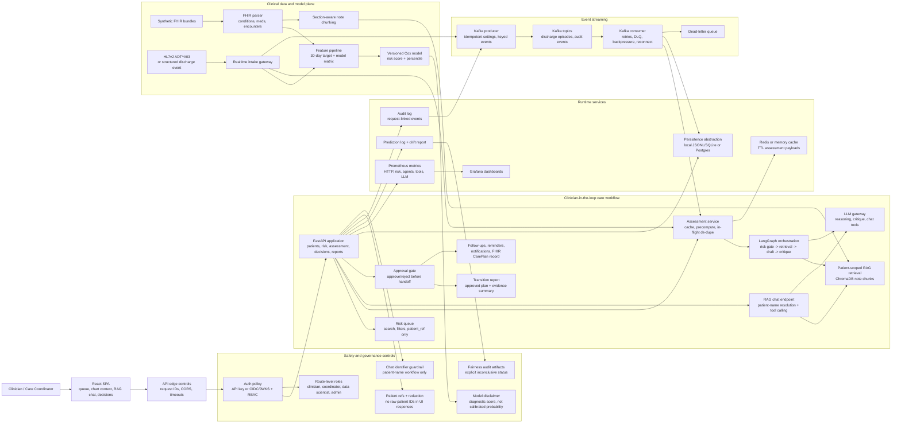

# Care Transition Copilot

[](https://www.python.org/downloads/)
[](https://github.com/Day-Raval/Care-Transition-Copilot/actions/workflows/ci.yml)
[](web/)
[](web/src/styles.css)
[](web/index.html)
[](scripts/)
[](LICENSE)

Care Transition Copilot is a synthetic-data healthcare AI demo that scores
30-day readmission risk, uses retrieval-augmented generation (RAG) over
patient-specific chart context, drafts a care-transition plan, powers a
RAG-backed clinician chat experience, and keeps a clinician in control before
anything is approved.

> Research and demo software only. Not for clinical use, not HIPAA validated,
> and not yet approved for real patient data or protected health information.

## Preview


## What It Does

- Presents a clinician work queue for recent discharge episodes, with search,
  filtering, patient history, risk category, review status, and precomputed
  care-plan state.
- Scores 30-day readmission risk through a versioned Cox survival model served
  by FastAPI, with feature validation generated from the configured model run.
- Parses synthetic FHIR bundles and HL7v2 ADT discharge messages into discharge
  episodes, derives risk features, and can trigger proactive assessment
  generation from intake events.
- Retrieves section-aware discharge-note context from a patient-scoped ChromaDB
  vector store so generated plans and chat answers are grounded in the selected
  patient record.
- Runs a LangGraph workflow that gates by risk, retrieves chart evidence,
  drafts a care-transition plan, and critiques the draft before clinician
  review.
- Provides a RAG-backed web chat that resolves patients by name, calls
  retrieval/risk tools, answers chart-specific follow-up questions, and avoids
  exposing raw patient IDs in the browser.
- Requires clinician approve/reject decisions before transition reports,
  follow-up tracking, reminders, notifications, or FHIR CarePlan write-back
  records are created.
- Supports API-key demo auth and OIDC/RBAC mode, with route-level role policy,
  restricted CORS, request IDs, safe error responses, patient references, and
  chat guardrails that reject raw patient identifiers.
- Persists decisions, care plans, audit events, prediction logs, notifications,
  FHIR write-back records, follow-ups, and reminders through local stores or a
  Postgres-backed runtime.
- Publishes Kafka audit and discharge events with idempotent producer settings;
  the consumer adds retries, duplicate suppression, DLQ routing, backpressure,
  reconnect handling, and graceful shutdown.
- Exposes health, dependency readiness, Prometheus metrics, drift reports,
  fairness audit outputs, LangSmith tracing hooks, and Grafana dashboards for
  operational review.
- Uses Redis or in-memory assessment caching, startup/on-demand precompute
  workers, in-flight request coalescing, bounded API limits, frontend timeouts,
  and LLM burst pacing to keep the MVP responsive during demos.
- Runs the built web app and API together on one local address, with validated
  startup, persistent approvals and reports, readable logs, and backup/restore.
- Keeps patient review and saved decisions accessible during Groq outages;
  new AI requests show a clear error with a request ID.
- Supports checksum-verified application updates with automatic rollback when
  installation or readiness fails, backed by Linux and Windows CI checks.

## MVP Architecture

The MVP is built as a production-shaped clinical workflow, not a single script:
the browser, API, model serving, agent orchestration, retrieval, persistence,
event streaming, observability, and integration adapters are separated so each
boundary can be operated, tested, and replaced independently.



The API layer owns authentication, role checks, request correlation, CORS,
error shaping, patient-reference redaction, and runtime dependency reporting.
The RAG layer is shared by the automated care-plan workflow and the web chat:
both retrieve patient-scoped note chunks before generating answers, while chat
adds patient-name resolution and tool-calling for risk, medication, and chart
questions. The model layer remains versioned and auditable: predictions are
logged, drift can be computed against the training reference distribution, and
fairness results are documented as inconclusive at the current synthetic dataset
size.

The runtime can stay lightweight for local demos or switch to managed-style
services through environment configuration: Postgres for decisions, care plans,
audit events, notifications, FHIR write-back records, follow-ups, reminders,
and prediction logs; Redis for assessment cache; Kafka for discharge/audit
streams; Prometheus and Grafana for metrics; LangSmith for trace capture; and
Twilio SMS or a portal-stub channel for notifications. FHIR write-back is
represented as a persisted CarePlan resource record after clinician approval,
which keeps the handoff path reviewable without sending real patient data to an
external EHR.

## Current Status

| Area | Status |
| --- | --- |
| Synthetic FHIR/HL7 ingestion | Implemented |
| 30-day readmission target and baseline model | Implemented; diagnostic only |
| Fairness audit | Implemented; currently inconclusive at this dataset size |
| RAG retrieval and vector store | Implemented locally with patient-scoped ChromaDB chunks |
| Agent drafting and critique | Implemented with Groq-hosted models |
| Clinician React UI | Implemented locally with queue, approvals, operations, and RAG chat |
| API-key and OIDC/RBAC auth | Implemented |
| Postgres, Redis, Kafka, Twilio, Prometheus/Grafana | Configurable runtime integrations |
| FHIR write-back and reminders | Persisted records after clinician approval; no external EHR write is sent |
| Local deployment | Built React UI + FastAPI on `127.0.0.1:8080`; native Windows and Linux/WSL launchers |
| Startup and operations | Configuration/model/retrieval/storage validation, readiness, health, rotating logs |
| Restart and provider failures | Saved assessments, decisions, and approved reports survive restart and remain available during AI outages |
| Backup and updates | Verified state snapshots; versioned code packages with dependency sync and rollback |
| GitHub Actions | Secret scanning, Linux/Windows Python and browser tests, gated release packaging |
| Deployment posture | Synthetic local MVP; versioned releases are installed manually on the local machine |

## Quick Start: Local Deployment

Run commands from the repository root. This serves the built React app and
FastAPI together at **http://127.0.0.1:8080**, with API routes under `/api`.
See [Local deployment](Docs/LOCAL_DEPLOYMENT.md) for the complete procedure.

### Prerequisites and configuration

- Python 3.12, `uv`, and Node.js/npm; Node 24.19.0 is the verified frontend version.
- A provisioned model, processed patient data, and Chroma vector store (see below).
- `.env` with a stable random `API_KEY` and a valid `GROQ_API_KEY` for new AI work.
  Replace the template `PATIENT_REF_SALT` with a stable random value, or remove
  it to use `API_KEY` as the reference salt. Keep these values stable across restarts.
- Internet access for dependency installation, the first uncached embedding-model
  download, and new Groq drafting, critique, and chat requests.

The installer syncs exact Python versions from `requirements.lock`, installs
frontend dependencies with `npm ci`, and runs `npm run build:local`.
Docker, Postgres, Redis, and Kafka are optional for other runtime profiles.

### Windows PowerShell

WSL is not required. Copy the template only when `.env` is absent, then edit it
with the configuration above before checking or running:

```powershell
if (-not (Test-Path .env)) { Copy-Item .env.example .env }
powershell -ExecutionPolicy Bypass -File scripts/local.ps1 -Command install
powershell -ExecutionPolicy Bypass -File scripts/local.ps1 -Command check
powershell -ExecutionPolicy Bypass -File scripts/local.ps1 -Command run
```

### WSL / Linux

Use Python, `uv`, and Node/npm available inside the Linux environment. For the
Windows-mounted checkout shown below, open WSL and run:

```bash
cd /mnt/c/Users/dayes/Downloads/Care_Transition_Copilot
test -f .env || cp .env.example .env
# Edit .env before checking or running.
bash scripts/local.sh install
bash scripts/local.sh check
bash scripts/local.sh run
```

On Linux, replace the `cd` path with your checkout directory. WSL stores its
Python environment at `~/.cache/care-transition-copilot/local-venv` to avoid a
slow Windows-mounted virtual environment. Linux and native Windows use
`.venv-local`; `CARE_TRANSITION_LOCAL_VENV` overrides the shell launcher's path.

After the first installation, start the app with just the `run` command.
Open **http://127.0.0.1:8080** and stop with **Ctrl+C**. Run one instance against
this checkout at a time, including when switching between Windows and WSL.

### Provision a clean machine

Git does not include generated model or retrieval artifacts. Install dependencies,
restore a verified deployment backup, then run `check` and `run`. Required assets:

- `config.yaml` and its configured `models/<run_id>.joblib`.
- `data/processed/discharge_records_with_target.csv` and discharge notes.
- `data/processed/chroma_db` with a nonempty `discharge_notes` collection.
- `.env` with the deployment's stable key/reference salt.

Use matching model/data/vector-store assets. Do not retrain merely to start an
existing deployment. For a first synthetic dataset build, use the commands under
[Development](#development); Java 11+ is required to generate Synthea data.

## Reliability and Operations

The local launcher selects SQLite/JSONL persistence, memory caching, disabled
Kafka/tracing/external notifications, and manual precomputation without editing
`.env`. Existing Postgres records remain in Postgres; local decisions and plans
use `results/care_delivery`.

- **Validated startup:** `check` and startup validate configuration, model loading,
  nonempty data and finite scores, a real patient-scoped embedding/retrieval query,
  SQLite integrity/write access, JSONL readability, report directories, and the
  frontend build before the application accepts browser traffic.
- **Persistent review:** saved assessments, approvals/rejections, and approved
  reports survive restart. Reports are saved at approval and replaced atomically;
  downloading an existing report does not require new AI generation.
- **Provider failures:** Groq connection, authentication, timeout, or provider
  failures return safe HTTP 503 errors with request IDs. Patient browsing, saved
  assessments, decisions, and reports remain available.
- **Browser fixes:** name search handles synthetic numeric name suffixes; rapid
  patient selection cannot overwrite the latest selection with an older response;
  care plans select the correct discharge episode; saved review state remains
  visible when generation fails.
- **Local authentication:** the browser receives the demo API key from runtime
  configuration. Restart after changing `.env`; rebuilding the frontend is not
  required for a key change. Groq/database credentials stay on the server. This
  API-key mode is intended for the loopback synthetic demo.
- **Operations:** the Operations page shows dependency health, model/drift status,
  audit events, and handoff records. UTF-8 console logs and rotating
  `logs/pipeline.log` support troubleshooting with request IDs.

With the app running, use `curl` on Linux/WSL or `curl.exe` on Windows:

```bash
curl http://127.0.0.1:8080/api/ready
curl http://127.0.0.1:8080/api/health
```

`/api/ready` returns HTTP 200 after local validation independently of Groq.
`/api/health` reports dependencies and the last observed AI state:
`not_checked`, `not_configured`, `available`, or `unavailable`. A provider failure
marks health degraded; a successful subsequent provider call clears that state.
Readiness alone does not verify the provider connection.

### Troubleshooting startup

**Port 8080 is in use:** check whether the app is already running and open its
browser address. The launcher does not kill the port's owner. Stop the old app
with Ctrl+C or choose another port for both `check` and `run`:

```powershell
powershell -ExecutionPolicy Bypass -File scripts/local.ps1 -Command check -Port 8088
powershell -ExecutionPolicy Bypass -File scripts/local.ps1 -Command run -Port 8088
```

```bash
bash scripts/local.sh check --port 8088
bash scripts/local.sh run --port 8088
```

Then open `http://127.0.0.1:8088`.

**WSL dependency downloads time out:** test HTTPS from the same WSL terminal:

```bash
curl -I --connect-timeout 10 https://pypi.org/simple/
```

The October 14 WSL connectivity issue was resolved with mirrored networking. For setup
details, see [Microsoft's WSL networking guide](https://learn.microsoft.com/en-us/windows/wsl/networking#mirrored-mode-networking).
Once connectivity works, rerun `bash scripts/local.sh install`. If HTTPS works
but `uv` still fails, also check the failing package URL and proxy settings.

## Backup, Restore, and Updates

Stop all processes using this checkout before maintenance, including development
servers. The local launcher holds a deployment lock to prevent concurrent local
instances and maintenance operations.

```powershell
powershell -ExecutionPolicy Bypass -File scripts/local.ps1 -Command backup
# Replace the example archive name with the path printed by backup.
powershell -ExecutionPolicy Bypass -File scripts/local.ps1 -Command restore -Archive backups/local-TIMESTAMP.zip
powershell -ExecutionPolicy Bypass -File scripts/local.ps1 -Command check
powershell -ExecutionPolicy Bypass -File scripts/local.ps1 -Command run
```

```bash
bash scripts/local.sh backup
# Replace the example archive name with the path printed by backup.
bash scripts/local.sh restore --archive backups/local-TIMESTAMP.zip
bash scripts/local.sh check
bash scripts/local.sh run
```

Snapshots include `.env`, configuration, models, processed data/vector store,
results, and reports. They exclude application code, frontend builds, raw FHIR
files, embedding-model caches, and dependencies; retain the matching source
revision and lockfiles separately. **Backups contain credentials: protect them
and do not upload them to GitHub.** Restore verifies checksums and safe paths
before replacing state, retaining previous state under `backups/before-restore-*`.

For packaged updates, download a trusted application ZIP and `SHA256SUMS` from
this repository's release, then stop the app. The following uses `v0.2.0` as an
example future release; substitute the version you actually downloaded:

```powershell
powershell -ExecutionPolicy Bypass -File scripts/local.ps1 -Command update `
  -Archive backups/downloads/care-transition-copilot-v0.2.0.zip `
  -Checksums backups/downloads/SHA256SUMS
powershell -ExecutionPolicy Bypass -File scripts/local.ps1 -Command run
```

```bash
bash scripts/local.sh update \
  --archive backups/downloads/care-transition-copilot-v0.2.0.zip \
  --checksums backups/downloads/SHA256SUMS
bash scripts/local.sh run
```

The updater verifies the archive and per-file manifest, backs up code and state
under `backups/update-<timestamp>`, installs application files and locked
dependencies, and checks readiness. Installation/readiness failure triggers
restoration of the previous code, dependencies, and state, followed by rollback
validation. Recovery files remain available if rollback itself fails. The app
stays stopped until you run it again. Use a dedicated deployment checkout if you
also develop locally: packaged updates replace managed application files.

See [CI/CD update and recovery details](Docs/CI_CD.md).

## GitHub Actions CI/CD

| Trigger | Result |
| --- | --- |
| Push to `main`, pull request, or manual CI run | Gitleaks secret scan; Python tests, local UI build, and Chromium workflows on Linux and Windows |
| Manual Release run | Same CI gate, then a downloadable preview package; no GitHub Release is published |
| Push a new `v*` version tag | Same CI gate, then package/checksum verification and publication as a GitHub Release |

CI pins Python **3.12.10**, Node **24.19.0**, and uv **0.11.3**, and uses the
Python/frontend lockfiles. GitHub Actions are pinned to commit SHAs. Repository
permissions are read-only by default; only tagged release publication receives
write access. Test artifacts are retained for seven days, preview packages for
30 days. Packaging requires a commit from `main` history.

Packages contain application code, launch/update scripts, lockfiles, documentation,
the built UI, and a version/commit/file-checksum manifest. They exclude `.env`,
`config.yaml`, model/data artifacts, user state, reports, backups, and installed
dependencies. A release package does not replace a deployment-state backup.
GitHub Actions does not connect to or automatically update your laptop; apply
approved releases locally with the update command above.

For a preview, open **Actions > Release > Run workflow**, choose `main` and
`v0.0.0-preview`, then download the **local-deployment** artifact after success.
Extract the outer Actions archive to obtain the application ZIP and `SHA256SUMS`.
Tag publication commands and the full pipeline are in [CI/CD](Docs/CI_CD.md).

## Verification: October 14, 2026

| Check | Verified result |
| --- | --- |
| Provisioned local Python suite | 101 passed, including approval/assessment/report reads after process restart |
| GitHub CI on Linux and Windows | 100 passed and one intentionally skipped provisioned-runtime test on each platform; secret scan passed |
| Browser workflows | Eight passed on each CI platform: navigation, patient review, approval/report/handoff, care plans, chat/retry, provider outage, rapid selection, and operations |
| Live provider checks | Groq drafting, critique, and chat returned HTTP 200 separately from fixture-based browser tests; WSL provider connectivity verified |
| Backup and updates | Backup restore, successful release update, and deliberately failed update with validated rollback checked in a separate deployment copy |
| Release preview | CI gate and downloadable package/checksum verification succeeded; no versioned GitHub Release was published |

Evidence: [successful CI run](https://github.com/Day-Raval/Care-Transition-Copilot/actions/runs/38603684934)
and [successful release preview](https://github.com/Day-Raval/Care-Transition-Copilot/actions/runs/38603770642).
These results describe the tested revision and environments, not a guarantee for
every future configuration or provider response.

Browser tests create isolated synthetic data, a fitted Cox model, and a Chroma
store. They exercise real application APIs, scoring, retrieval, and persistence
with deterministic hosted-AI responses and test embeddings, including outages.
They require no provider secrets and do not measure semantic or clinical quality.
The separate process-restart test requires provisioned assets and skips on a clean
checkout. Test-only controls are absent from the deployed app.

To rerun locally on Windows:

```powershell
.venv-local/Scripts/python.exe -m pytest -q
cd web
npm ci
npm run build:local
npx playwright install chromium
npm run test:e2e
```

For WSL browser tests, use Linux Node/npm and set `CARE_TRANSITION_TEST_PYTHON`
to the absolute path of `~/.cache/care-transition-copilot/local-venv/bin/python`.
Linux installations can use `.venv-local/bin/python` from the project root.

## Development

The development server remains available separately at `http://127.0.0.1:5173`.
Use a development Python environment and install the locked dependencies:

```bash
uv venv --python 3.12
uv pip sync requirements.lock
```

Set `VITE_API_KEY` to match `API_KEY` for the development frontend. To build a
first synthetic dataset/model, activate the environment and run:

```bash
source .venv/bin/activate
bash scripts/generate_synthetic_data.sh
python scripts/export_records.py
python -m src.features.target
python -m src.model.run_experiment --alpha 1.0 --notes "baseline, 6 features"
# Set model.production_run_id in config.yaml to the run ID printed above.
python -m src.embeddings.build_vector_store
python -m src.embeddings.validate_vector_store
```

For PowerShell Python commands, activate with `.venv\Scripts\Activate.ps1`.
Synthea generation uses the shell script and Java. Stop the local deployment
before starting development servers. Use `bash dev.sh` on Linux/WSL or
`npm run dev:full:win` from `web` on Windows (the
Windows development launcher uses WSL). Use the native local launcher above for
a deployment without WSL. WSL's development launcher uses a separate environment
at `~/.cache/care-transition-copilot/venv` unless `CARE_TRANSITION_VENV` points
to the Linux environment you prepared. Standalone development API routes omit the `/api`
prefix, for example `http://127.0.0.1:8080/health`.

## Common Commands

```bash
# Run Python tests and the development frontend build (not the full CI pipeline)
bash scripts/check.sh

# Windows equivalent
powershell -ExecutionPolicy Bypass -File scripts/check.ps1

# Run API only
bash dev.sh --api-only

# Run selected model diagnostics
python -m src.model.compare_models
python -m src.model.fairness_audit

# Run the agent pipeline for one patient
python -m src.agents.orchestrator <patient_id>

# Start local observability
docker compose -f docker-compose.observability.yml up
```

## Project Structure

```text
src/
|-- agents/         # Risk tool, retrieval, reasoning, critique, chat, orchestration
|-- api/            # FastAPI app, auth, persistence, metrics, drift, reports
|-- data_services/  # Kafka, notifications, idempotency, runtime data services
|-- embeddings/     # Note chunking and ChromaDB build/validation
|-- features/       # Readmission target construction
|-- ingestion/      # FHIR/HL7 parsing, temporal filters, episode clustering
|-- model/          # Training, comparison, experiment registry, fairness audit
`-- retrieval/      # Patient-scoped vector queries

web/
|-- src/            # React clinician UI
|-- tests/          # Chromium user-flow tests
|-- playwright.config.js
`-- package.json    # Vite scripts

scripts/
|-- local.ps1       # Native Windows install/check/run/backup/restore/update
|-- local.sh        # Linux/WSL launcher
|-- local.py        # Deployment maintenance and state snapshots
`-- release.py      # Checksummed application packages and update/rollback

.github/workflows/  # Linux/Windows CI and gated release publication
requirements.lock  # Exact Python dependency versions
database/           # Postgres migration and verification helpers
Docs/               # Architecture, detailed README, data docs, diagrams
tests/              # Python regressions, restart tests, isolated browser fixtures
```

## Documentation

- [Local deployment: setup, readiness, persistence, backup/restore](Docs/LOCAL_DEPLOYMENT.md)
- [CI/CD: GitHub Actions, releases, updates, and rollback](Docs/CI_CD.md)
- [Detailed implementation notes](Docs/README_DETAILED.md)
- [Architecture](ARCHITECTURE.md)
- [Security model](SECURITY.md)
- [Data card](Docs/DATA_CARD.md)
- [Model card](Docs/MODEL_CARD.md)
- [Changelog](CHANGELOG.md)
- [FHIR/HL7 data documentation](Docs/data_documentation.md)
- [Database migration notes](database/README.md)

## Data and Model Limits

This repo uses synthetic Synthea data only. The current modeling workflow is
diagnostic: the available readmission event count is small, the risk score is a
relative model output rather than a calibrated probability, and subgroup
fairness results are not yet statistically determinate.

Before any real clinical or PHI use, the project would need clinical validation,
calibration, privacy review, security review, deployment hardening, monitoring,
retention/deletion workflows, and approved integrations with the target EHR and
model providers.

## Contributing

Issues and pull requests should use synthetic data only. See
[CONTRIBUTING.md](CONTRIBUTING.md), [CODE_OF_CONDUCT.md](CODE_OF_CONDUCT.md),
and [SECURITY.md](SECURITY.md) before opening changes that touch auth, patient
data flow, model behavior, or generated clinical text.

## License

MIT. See [LICENSE](LICENSE).
