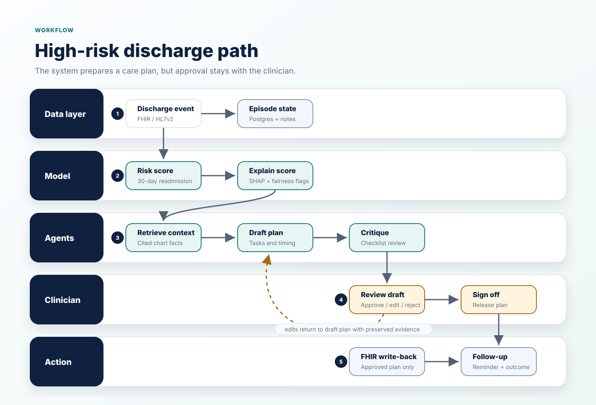
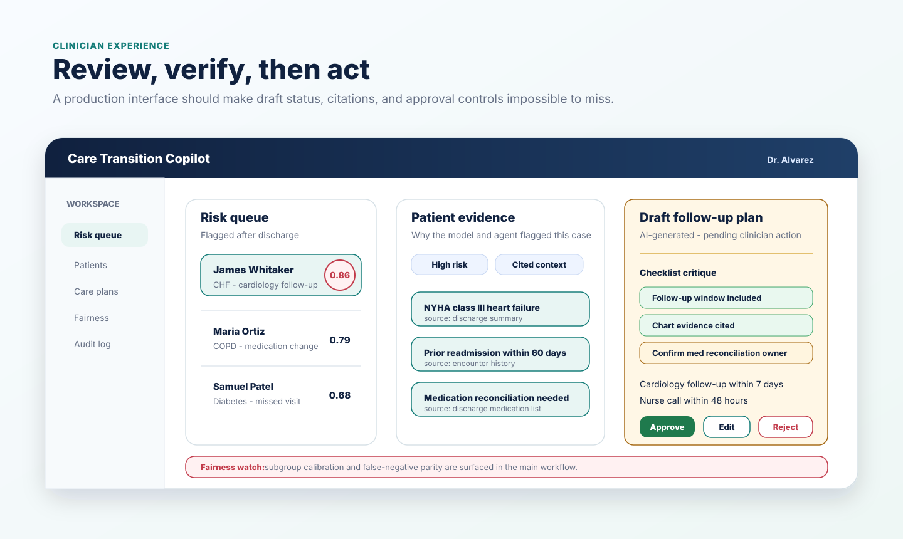
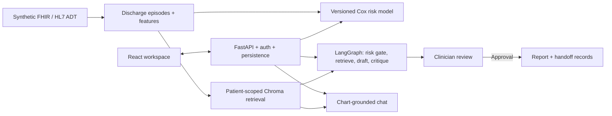

# Care Transition Copilot

[](https://github.com/Day-Raval/Care-Transition-Copilot/actions/workflows/ci.yml)
[](pyproject.toml)
[](web/README.md)
[](LICENSE)

**From discharge risk to a clinician-reviewed transition plan.**

Care Transition Copilot is a synthetic-data healthcare AI MVP that brings readmission risk, patient-specific chart evidence, AI-assisted care planning, and clinician approval into one workspace. It demonstrates the path from discharge intake to a saved transition report, with RAG-backed chat for follow-up questions.

> Research and demonstration software only. Not for clinical use, not HIPAA validated, and not approved for real patient data or protected health information.

[Run locally](#run-locally) · [Demo walkthrough](#demo-walkthrough) · [Architecture](ARCHITECTURE.md) · [Documentation](Docs/README.md)

## Preview





## The MVP experience

| Capability | What the demo shows |
| --- | --- |
| Prioritize discharges | A searchable risk queue with risk category, discharge episode, and review state |
| Understand the patient | Patient history and patient-scoped retrieval over section-aware discharge-note chunks |
| Draft with evidence | Risk-gated LangGraph orchestration: retrieve, draft, and critique; low-risk cases use a brief summary |
| Keep clinicians in control | Approve or reject before reports and downstream handoff records are created |
| Ask follow-up questions | Tool-calling chat for patient-specific chart and risk questions |
| Continue after restart | Saved assessments, decisions, and approved reports persist locally |
| Inspect operations | Dependency health, request IDs, audit events, drift outputs, and optional metrics dashboards |

## Demo walkthrough

With a provisioned app running at **http://127.0.0.1:8080**:

1. Open **Risk queue**, filter discharges, and select a medium- or high-risk episode.
2. Review the patient's history, risk assessment, chart evidence, draft plan, and critique.
3. Approve or reject the plan. For an approval, download the transition report and inspect the handoff records.
4. Open **Care plans** to revisit saved work; use **Patients** to inspect history.
5. Use **Ask a question** with the patient's displayed name to explore chart context.
6. Open **Operations** to inspect dependencies and audit activity.

New drafting, critique, and chat need a working AI provider. Patient browsing and saved review/report reads remain available during provider outages. FHIR write-back is a persisted CarePlan record; the demo does not send it to an external EHR.

## How it works



The local profile uses SQLite/JSONL state and in-memory caching. Configurable integrations include Postgres, Redis, Kafka, OIDC/RBAC, notifications, Prometheus/Grafana, and LangSmith. These services are optional for the local showcase. See [backend modules](src/README.md) and the [full architecture](ARCHITECTURE.md).

## Run locally

### Prerequisites

- Python 3.12, `uv`, and Node.js/npm. CI pins Python 3.12.10, Node 24.19.0, and uv 0.11.3.
- A configured `.env`: set a stable random `API_KEY`, a valid `GROQ_API_KEY`, and replace the template `PATIENT_REF_SALT` with a stable random value (or remove it to use `API_KEY`).
- Matching trained model, processed patient data, discharge notes, and a nonempty Chroma vector store. **A fresh clone does not include these generated assets.** Restore a verified deployment backup or follow the [first-time pipeline guide](src/README.md#build-the-synthetic-pipeline).
- Internet for dependency installation, the first uncached embedding download, and new hosted AI requests.

### Windows PowerShell

Run from the repository root. Edit `.env` before checking or starting:

```powershell
if (-not (Test-Path .env)) { Copy-Item .env.example .env }
powershell -ExecutionPolicy Bypass -File scripts/local.ps1 -Command install
powershell -ExecutionPolicy Bypass -File scripts/local.ps1 -Command check
powershell -ExecutionPolicy Bypass -File scripts/local.ps1 -Command run
```

### Linux / WSL

Use Linux Python, `uv`, and Node/npm from your checkout directory:

```bash
test -f .env || cp .env.example .env
# Edit .env before checking or starting.
bash scripts/local.sh install
bash scripts/local.sh check
bash scripts/local.sh run
```

Open **http://127.0.0.1:8080**; stop with **Ctrl+C**. Subsequent starts only need `run`. The built UI and API share one address; API routes use `/api`. Run one instance against the state at a time. Local API-key mode delivers the demo key to the browser and is intended for a trusted, single-user loopback demo.

See [local deployment](Docs/LOCAL_DEPLOYMENT.md) for provisioning, alternative ports, logs, backup/restore, and troubleshooting. `/api/ready` validates local dependencies; it does not verify live Groq connectivity.

### Containers

The multi-stage Dockerfile provides a non-root application image and a separate CI image. With Docker's Linux engine and the same provisioned configuration/data/model assets:

```bash
docker compose up -d --build
curl --fail http://127.0.0.1:8080/api/ready
```

Stop the native app first. Prepare writable state directories and Linux UID/GID 10001 permissions as described in the [container guide](Docs/CONTAINERS.md). Images exclude credentials, datasets, models, vector stores, and saved state; building an image does not provision them.

## Recent delivery milestones

These summarize recent committed changes through October 21, 2026; they are implementation milestones, not new test results.

| Change | Result |
| --- | --- |
| Persistent local deployment | Windows and Linux/WSL launchers, startup validation, deployment locking, rotating logs, and saved clinician workflows |
| Patient and review fixes | Cleaner names/history text, numeric-suffix search, correct episode selection, and protection against stale patient-selection responses |
| Provider failure handling | Safe 503 responses with request IDs; saved assessments, decisions, and reports remain readable |
| Verified maintenance | Checksummed backups/packages, dependency sync, readiness validation, and rollback on failed updates |
| Cross-platform CI | Secret scanning, native Windows tests, Linux container tests, and isolated Chromium workflows |
| Container releases | Tagged-release automation for runtime/CI GHCR images, version/commit tags, SBOM/provenance, and release ZIP/checksums |
| Documentation cleanup | Removed an unused stakeholder image; retained the workflow and clinician-review previews above |

Manual Release runs build previews without publishing. The container guide records that the new publishing path still needed a preview and first tagged run at its October 21 review. See [CI/CD](Docs/CI_CD.md) for release/update procedures and [CHANGELOG.md](CHANGELOG.md) for project history.

## Validation and MVP boundaries

Python regressions cover API security, patient scoping, persistence, retrieval, notifications, caching, release validation, and rollback. Chromium workflows exercise the clinician journey using isolated synthetic assets and deterministic provider/embedding fixtures. A separate provisioned-runtime test checks reads across process restarts. See [test instructions and limits](tests/README.md).

The October 14 documentation recorded 101 provisioned-local Python passes, 100 passes plus one provisioned-runtime skip on each CI platform, and eight browser workflows per platform. Those are historical results for that revision, before the new container path; this README refresh does not rerun or certify them.

The model produces a relative diagnostic risk score, **not a calibrated probability**. Synthetic readmission events are limited, subgroup fairness findings are inconclusive, and fixture-based workflow tests do not establish clinical or generated-text quality. See the [model card](Docs/MODEL_CARD.md), [data card](Docs/DATA_CARD.md), and [security model](SECURITY.md).

## Repository guide

| Folder | Start here |
| --- | --- |
| `src/` | [Backend modules and synthetic pipeline](src/README.md) |
| `web/` | [Clinician UI, development modes, and browser tests](web/README.md) |
| `scripts/` | [Launchers, maintenance, and diagnostic utilities](scripts/README.md) |
| `tests/` | [Regression tests and fixture boundaries](tests/README.md) |
| `Docs/` | [Setup, architecture, deployment, and model/data docs](Docs/README.md) |
| `.github/` | [CI and release automation](.github/README.md) |
| `database/` | [Postgres migration and verification](database/README.md) |
| `observability/` | [Prometheus and Grafana](observability/README.md) |
| `results/` | [Modeling, care delivery, and operational outputs](results/README.md) |
| `reports/` | [Generated reports](reports/README.md) |

See [CONTRIBUTING.md](CONTRIBUTING.md) and [CODE_OF_CONDUCT.md](CODE_OF_CONDUCT.md) before contributing. Use synthetic data only in issues and pull requests. Licensed under [MIT](LICENSE).
